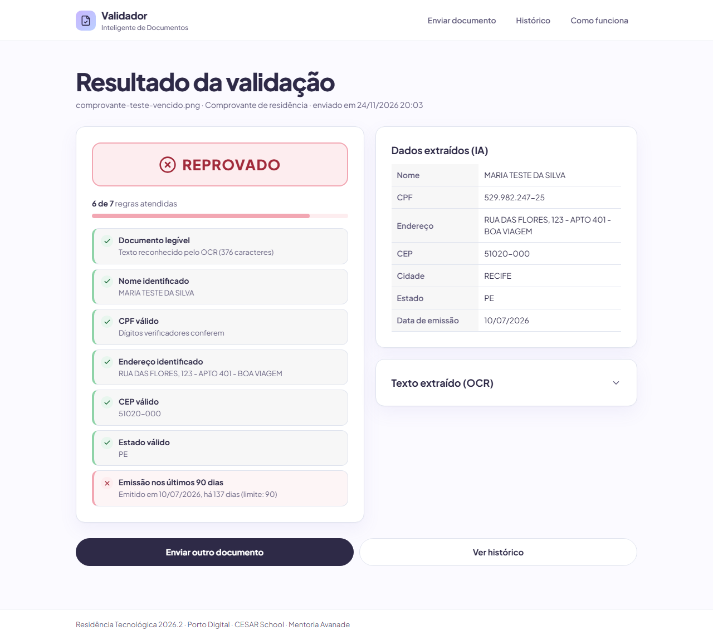
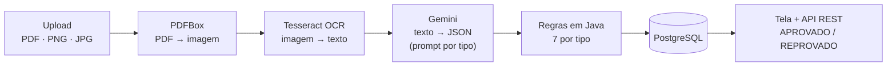
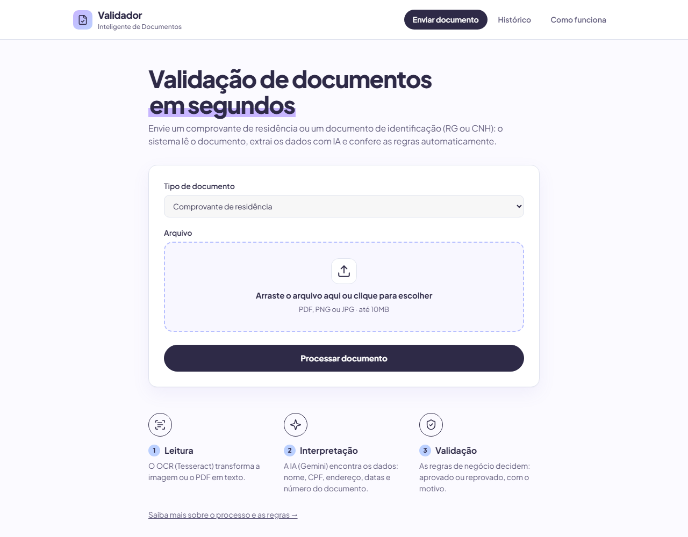
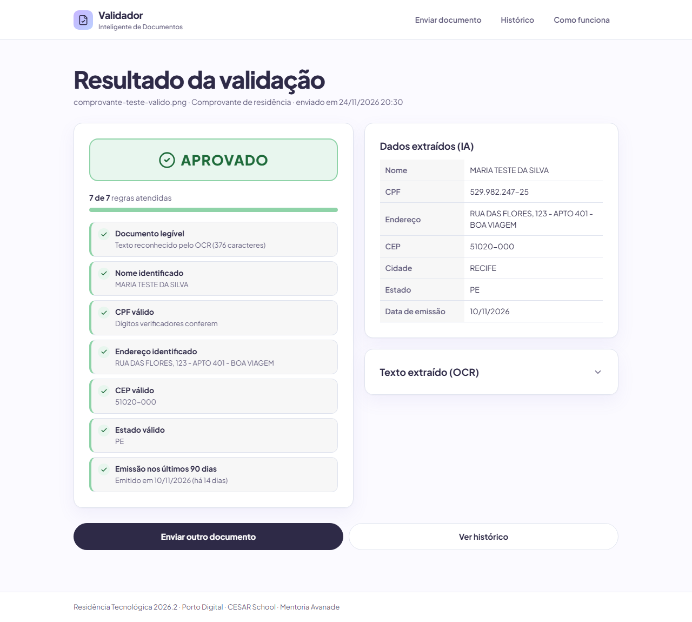
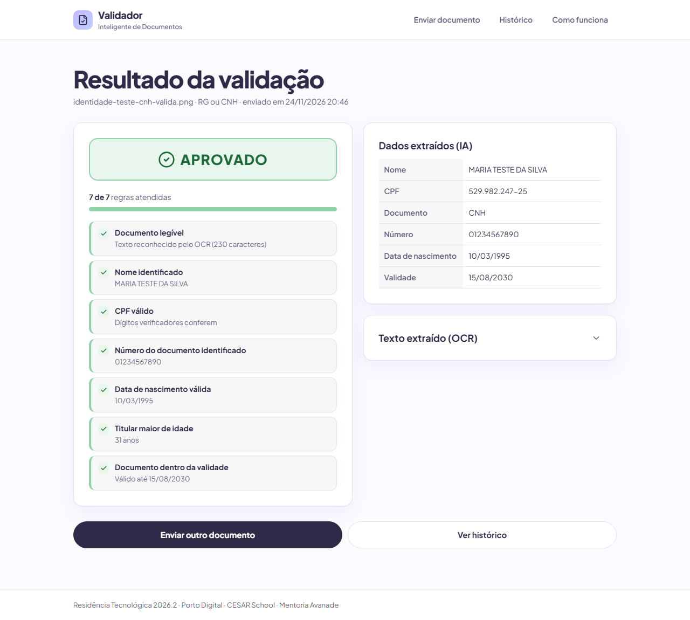
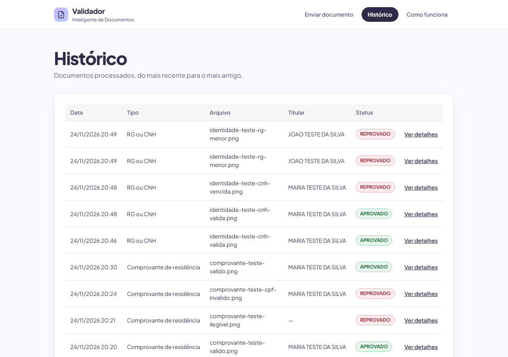
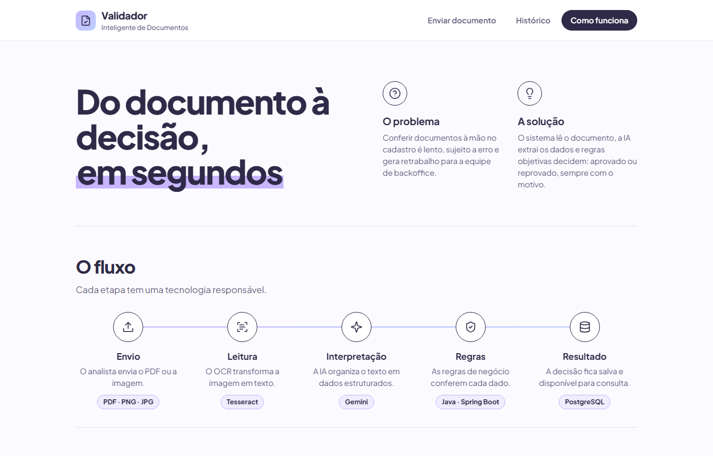

# Validador Inteligente de Documentos

Projeto do semestre 2026.2 — Residência Tecnológica (Porto Digital · CESAR School · mentoria Avanade).

Aplicação em **Java + Spring Boot** que recebe documentos digitais (PDF/imagem) — **comprovante de residência** e **documento de identificação (RG ou CNH)** —, extrai as informações com **OCR (Tesseract)** e **IA (Google Gemini)**, aplica **regras de negócio** e devolve se o documento foi **APROVADO ou REPROVADO** — sempre com o motivo —, guardando o resultado no **PostgreSQL** para consulta pela tela e por uma **API REST**.



---

## Sumário

1. [Entendimento do problema](#1-entendimento-do-problema)
2. [Fluxo da solução](#2-fluxo-da-solução)
3. [Telas](#3-telas)
4. [Tecnologias](#4-tecnologias)
5. [Arquitetura](#5-arquitetura)
6. [Como rodar](#6-como-rodar)
7. [API REST](#7-api-rest)
8. [Regras de validação](#8-regras-de-validação)
9. [Testes](#9-testes)
10. [Decisões técnicas e trade-offs](#10-decisões-técnicas-e-trade-offs)
11. [Limitações e próximos passos](#11-limitações-e-próximos-passos)
12. [Aprendizados](#12-aprendizados)

---

## 1. Entendimento do problema

| Item | Definição |
|---|---|
| **Problema** | A validação manual de documentos no cadastro de clientes é lenta, sujeita a erro e gera retrabalho e risco operacional. |
| **Usuário** | Analista de cadastro / backoffice que precisa conferir documentos enviados por clientes. |
| **Documentos** | **Comprovante de residência** (MVP) e **documento de identificação — RG ou CNH**. |
| **Dados extraídos** | Comprovante: nome, CPF, endereço, CEP, cidade, estado e data de emissão. RG/CNH: nome, CPF, número do documento, tipo (RG ou CNH), data de nascimento e validade. |
| **Regras** | 7 regras por tipo de documento (ver [seção 8](#8-regras-de-validação)): legibilidade, nome e CPF em ambos; endereço, CEP, UF e emissão em até 90 dias no comprovante; número, nascimento, maioridade e validade no RG/CNH. |
| **Aprovação** | Todos os dados obrigatórios extraídos e **todas** as regras atendidas. |
| **Rejeição** | Documento ilegível, dados obrigatórios ausentes ou inválidos, comprovante emitido há mais de 90 dias, CNH vencida ou titular menor de idade. |

## 2. Fluxo da solução



1. O analista escolhe o tipo (comprovante ou RG/CNH) e envia o arquivo pela tela (ou outro sistema envia pela API).
2. PDFs são renderizados em imagem (300 DPI, até 3 páginas) e o **Tesseract** lê o texto em português.
3. O **Gemini** recebe o texto do OCR com o **prompt do tipo de documento** e devolve um JSON com os campos (`null` quando não encontra — o prompt proíbe inventar).
4. O `ValidacaoService` aplica as **7 regras daquele tipo**; o documento só é aprovado se todas passarem.
5. Tudo é gravado no **PostgreSQL** (texto do OCR, dados extraídos, status e o checklist de regras) e fica disponível no histórico e na API.

> Se a IA estiver indisponível, o documento **não é reprovado**: ele é gravado como "não validado", com o motivo do erro. Falha da nossa infraestrutura não pode prejudicar o cliente.

## 3. Telas

| Envio | Resultado (aprovado) |
|---|---|
|  |  |

| Resultado (CNH) | Histórico |
|---|---|
|  |  |

| Como funciona |
|---|
|  |

- **Enviar documento:** escolha do tipo (comprovante ou RG/CNH), área de arrastar e soltar, aviso imediato para arquivos acima de 10MB e botão "Processando…" durante o envio.
- **Resultado:** selo APROVADO/REPROVADO, resumo "X de 7 regras atendidas", checklist com o motivo de cada regra, dados extraídos pela IA (os campos mudam conforme o tipo) e o texto do OCR (recolhível).
- **Histórico:** todos os documentos processados, com o tipo, do mais recente para o mais antigo.
- **Como funciona:** explica o problema, o fluxo, como usar, as regras e a API.

Identidade visual em tons pastel (lilás `#C8B6FF`, lavanda `#B8C0FF`, azul `#BBD0FF`), fonte Plus Jakarta Sans e layout responsivo (celular sem rolagem horizontal).

## 4. Tecnologias

| Tecnologia | Papel |
|---|---|
| **Java 17 + Spring Boot 4.1** | Backend, regras de negócio, telas e API REST |
| **Thymeleaf** | Telas renderizadas no servidor |
| **Tesseract 5 (Tess4J 5.13)** | OCR — transforma a imagem em texto |
| **Apache PDFBox 3** | Converte páginas de PDF em imagem para o OCR |
| **Google Gemini (gemini-2.5-flash)** | Interpreta o texto e devolve JSON estruturado |
| **PostgreSQL 16 + Spring Data JPA** | Persistência dos documentos e resultados |
| **JUnit 5, Mockito, MockMvc, H2** | Testes unitários, de integração e da API |
| **Docker + Docker Compose** | Sobe aplicação + banco com um comando |
| **OpenCV 4.9 (openpnp)** | Base integrada para o pré-processamento de imagem (ver [próximos passos](#11-limitações-e-próximos-passos)) |

## 5. Arquitetura

Organização em camadas, com o fluxo centralizado num serviço usado tanto pela tela quanto pela API.

```
br.com.matheuslarre.validadordocumentos
├── controller/   DocumentoController (telas), ComoFuncionaController, UploadExceptionHandler
├── api/          DocumentoApiController (REST), DTOs (records), ApiExceptionHandler (ProblemDetail)
├── service/      ProcessamentoService (orquestra o fluxo), ArmazenamentoService (upload),
│                 OcrService (Tesseract + PDFBox), ConsultaDocumentoService (histórico)
├── ia/           GeminiService (um prompt por tipo, nova tentativa, timeout),
│                 DadosExtraidos (sealed interface) → DadosComprovante | DadosIdentificacao (records)
├── validacao/    ValidacaoService (regras de cada tipo), ResultadoValidacao, RegraResultado, StatusValidacao
├── model/        Documento (entidade JPA), RegraAplicada (tabela filha do checklist), TipoDocumento (enum)
├── repository/   DocumentoRepository (Spring Data JPA)
├── config/       RelogioConfig (Clock), OpenCvConfig
└── imagem/       ConversorImagem (BufferedImage ↔ Mat do OpenCV)
```

| Camada | Responsabilidade |
|---|---|
| **Controller / API** | Só HTTP: recebe a requisição, chama o serviço e decide a resposta (tela ou JSON). |
| **ProcessamentoService** | Orquestra salvar → OCR → IA → regras → banco. É o "coração" do fluxo. |
| **ValidacaoService** | Regras de negócio puras: sem banco, sem HTTP, fáceis de testar. |
| **Repository** | Acesso ao banco gerado pelo Spring Data a partir de uma interface. |

## 6. Como rodar

### Opção 1 — Docker (recomendado: um comando só)

**Pré-requisito:** Docker Desktop aberto.

```powershell
# 1. Crie o .env a partir do exemplo e preencha GEMINI_API_KEY
Copy-Item .env.example .env

# 2. Suba aplicação + PostgreSQL (o build roda os testes)
docker compose up --build
```

Acesse **http://localhost:8080**. Para parar: `docker compose down` (os dados continuam salvos nos volumes).

O `compose.yaml` sobe o PostgreSQL com *healthcheck* e só inicia a aplicação quando o banco está pronto. A imagem da aplicação já traz o Tesseract com o idioma português.

### Opção 2 — Local (para desenvolver)

**Pré-requisitos:** Java 17+, [Tesseract OCR](https://github.com/UB-Mannheim/tesseract/wiki) com o idioma **Portuguese** e Docker (para o banco).

```powershell
# 1. Só o banco, no Docker
docker compose up -d db

# 2. A aplicação, com o Maven Wrapper
.\mvnw.cmd spring-boot:run
```

### Variáveis de ambiente (`.env`)

| Variável | Obrigatória | Padrão | Descrição |
|---|---|---|---|
| `GEMINI_API_KEY` | Sim | — | Chave do [Google AI Studio](https://aistudio.google.com). |
| `GEMINI_MODEL` | Não | `gemini-2.5-flash` | Modelo do Gemini. |
| `TESSDATA_PATH` | Não | `C:/Program Files/Tesseract-OCR/tessdata` | Pasta de idiomas do Tesseract (no Docker já vem configurada). |
| `DB_URL` / `DB_USER` / `DB_PASSWORD` | Não | `jdbc:postgresql://localhost:5432/validador` / `validador` / `validador` | Conexão com o PostgreSQL. |

O `.env` está no `.gitignore` e no `.dockerignore`: a chave nunca vai para o Git nem para dentro da imagem.

## 7. API REST

| Método | Endpoint | Descrição | Resposta |
|---|---|---|---|
| `POST` | `/api/documentos` | Envia um documento (multipart: `tipo` + `arquivo`); `tipo` = `COMPROVANTE_RESIDENCIA` ou `DOCUMENTO_IDENTIFICACAO` | **201** + `Location` + JSON do resultado |
| `GET` | `/api/documentos` | Lista o histórico resumido | **200** |
| `GET` | `/api/documentos/{id}` | Detalhe completo (regras, dados, OCR) | **200** ou **404** |

```powershell
# Enviar um documento
curl.exe -i -F "tipo=COMPROVANTE_RESIDENCIA" -F "arquivo=@comprovante.png;type=image/png" http://localhost:8080/api/documentos

# Listar e detalhar
curl.exe http://localhost:8080/api/documentos
curl.exe http://localhost:8080/api/documentos/{id}
```

Exemplo de resposta (resumida):

```json
{
  "id": "74b9119d-a6a9-4d4f-a539-a34180f30d47",
  "criadoEm": "2026-11-24T20:30:27",
  "arquivo": "comprovante-teste-valido.png",
  "tipo": "COMPROVANTE_RESIDENCIA",
  "status": "APROVADO",
  "erroProcessamento": null,
  "regras": [
    { "nome": "CPF válido", "aprovada": true, "motivo": "Dígitos verificadores conferem" },
    { "nome": "Emissão nos últimos 90 dias", "aprovada": true, "motivo": "Emitido em 10/11/2026 (há 14 dias)" }
  ],
  "dados": { "nome": "MARIA TESTE DA SILVA", "cpf": "529.982.247-25", "cep": "51020-000", "estado": "PE", "dataEmissao": "2026-11-10" }
}
```

Erros seguem o padrão **ProblemDetail (RFC 9457)**:

```json
{ "title": "Documento não encontrado", "status": 404, "detail": "Documento abc não encontrado.", "instance": "/api/documentos/abc" }
```

| Status | Quando |
|---|---|
| `400` | Arquivo vazio, formato não suportado, tipo de documento desconhecido ou parâmetro ausente |
| `404` | Documento inexistente (ou id malformado) |
| `422` | O arquivo chegou, mas não foi possível ler (PDF/imagem corrompidos) |

## 8. Regras de validação

### Comprovante de residência

| # | Regra | Como é verificada |
|---|---|---|
| 1 | **Documento legível** | O texto do OCR tem pelo menos 30 caracteres não brancos. |
| 2 | **Nome identificado** | A IA encontrou o nome do titular. |
| 3 | **CPF válido** | 11 dígitos, não é sequência repetida e os **dígitos verificadores** conferem (módulo 11). |
| 4 | **Endereço identificado** | A IA encontrou o endereço. |
| 5 | **CEP válido** | 8 dígitos depois de remover a pontuação. |
| 6 | **Estado válido** | Uma das 27 UFs brasileiras. |
| 7 | **Emissão recente** | Data presente, não futura e com **no máximo 90 dias**. |

### Documento de identificação (RG ou CNH)

| # | Regra | Como é verificada |
|---|---|---|
| 1 | **Documento legível** | Mesma regra do comprovante. |
| 2 | **Nome identificado** | A IA encontrou o nome completo do titular. |
| 3 | **CPF válido** | Mesma conferência do módulo 11. |
| 4 | **Número do documento** | Número do RG ou registro da CNH encontrado. |
| 5 | **Data de nascimento válida** | Presente, não futura e plausível (até 130 anos). |
| 6 | **Titular maior de idade** | 18 anos completos — é cadastro de cliente. |
| 7 | **Dentro da validade** | A CNH precisa ter validade e não estar vencida; o RG não tem validade e passa, com o motivo explicado. |

**Decisão:** APROVADO só se as 7 regras do tipo passarem. Cada regra devolve o motivo, que aparece no checklist (ex.: *"Emitido em 10/07/2026, há 137 dias (limite: 90)"*, *"Documento vencido em 15/08/2025"* ou *"Titular tem 16 anos (mínimo: 18)"*). Legibilidade, nome e CPF são **as mesmas regras** nos dois tipos — o código é reaproveitado, não copiado.

**Algoritmo do CPF (módulo 11):** o CPF tem 9 dígitos de base e 2 verificadores.
- 1º verificador: multiplica os 9 primeiros dígitos pelos pesos 10, 9, …, 2 e soma. `resto = soma % 11`; se `resto < 2`, o dígito é 0, senão é `11 − resto`.
- 2º verificador: o mesmo cálculo com os 10 primeiros dígitos e pesos 11, 10, …, 2.
- Exemplo `529.982.247-25`: a soma é 295, o resto é 9 e `11 − 9 = 2` ✓.

## 9. Testes

```powershell
.\mvnw.cmd test
```

**93 testes**, todos passando (também rodam dentro do `docker build`):

| Tipo | O que cobre |
|---|---|
| **Unitários** (`ValidacaoServiceTest`) | Cada regra, com casos de borda: emissão com exatamente 90 dias, com 91 e no futuro; CPF com dígito errado, repetido e com dígito verificador 0; 18 anos completos hoje (passa) e amanhã (falha); CNH que vence hoje (passa) e venceu ontem (falha); RG sem validade. O `Clock` é fixo, então os testes não "vencem". |
| **Unitários com Mockito** (`ProcessamentoServiceTest`) | A orquestração: IA fora do ar não reprova; documento ilegível não chama a IA; arquivo inválido não grava nada; RG/CNH usa o prompt e as regras certos; tipo desconhecido nem salva o arquivo. |
| **HTTP simulado** (`GeminiServiceTest`) | `MockRestServiceServer`: chave no cabeçalho, prompt certo por tipo, nova tentativa em 503, mensagem amigável e nenhuma nova tentativa em 404. A API real nunca é chamada. |
| **Integração com H2** (`DocumentoRepositoryTest`) | Mapeamento JPA: grava e lê o documento com o checklist na ordem certa. |
| **API com MockMvc** (`DocumentoApiControllerTest`) | Status 201/400/404, cabeçalho `Location`, formato ProblemDetail, DTOs e os campos de cada tipo de documento. |

## 10. Decisões técnicas e trade-offs

**Arquitetura e código**
- **Tesseract + Gemini, e não só uma IA multimodal lendo a imagem.** Seguimos o fluxo de referência (OCR → IA): o texto do OCR fica salvo e auditável, a IA recebe só texto (mais barato e rápido que imagem) e o provedor de IA pode ser trocado sem mexer na leitura. *Trade-off:* um erro de leitura do OCR passa para a IA.
- **Um serviço de processamento para tela e API.** O `ProcessamentoService` concentra o fluxo; os controllers só cuidam do HTTP. A regra não se repete em dois lugares.
- **Regras isoladas no `ValidacaoService`.** Sem banco nem HTTP, cada regra é testada em milissegundos.
- **`record` para dados imutáveis** (`DadosComprovante`, `RegraResultado`, DTOs): o Java gera construtor, getters, `equals` e `toString`, e o objeto não muda depois de criado.
- **`Clock` injetado com fuso `America/Sao_Paulo`.** Os testes fixam "hoje" numa data conhecida (senão o teste dos 90 dias quebraria com o tempo). O fuso explícito evita que, no Docker (UTC), a data vire o dia seguinte depois das 21h.
- **IA fora do ar não reprova o documento:** ele fica "não validado", com o motivo. OCR sem texto, por outro lado, reprova como ilegível.
- **Um novo tipo de documento sem reescrever o fluxo.** O RG/CNH entrou com: um `enum TipoDocumento`, um segundo prompt e um novo conjunto de regras. O `ProcessamentoService` escolhe prompt e regras com um `switch` sobre o enum — se um terceiro tipo for criado, o compilador aponta todos os lugares que precisam tratá-lo.
- **`sealed interface DadosExtraidos`** (Java 17): os dados extraídos só podem ser `DadosComprovante` ou `DadosIdentificacao`. O compilador garante que não existe um terceiro tipo "surpresa".
- **Método genérico na IA** (`<T> T extrair(prompt, texto, Class<T>)`): a chamada HTTP, a nova tentativa e a conversão do JSON são as mesmas para os dois documentos; só mudam o prompt e o record de destino.
- **Regras de negócio do RG/CNH:** maioridade (18 anos) porque o contexto é cadastro de cliente; e o RG, que normalmente não tem validade, passa nessa regra com o motivo explicado — em vez de ser reprovado por um campo que não existe nele.

**Integração com a IA**
- **Versão fixa do modelo (`gemini-2.5-flash`) em vez do apelido `latest`.** O apelido muda sozinho e é o mais disputado (nos testes, dava 503 por alta demanda). Fixar a versão dá previsibilidade, como fixar a versão de uma dependência no `pom.xml`.
- **Nova tentativa só para erros temporários (503 e 429), timeout e mensagem amigável.** O detalhe técnico vai para o log; o analista vê "O serviço de IA está sobrecarregado…". Um 404 (modelo errado) falha na hora, porque tentar de novo não resolve.
- **Chave no cabeçalho `x-goog-api-key`, nunca na URL** (URLs aparecem em logs). Prompt com `temperature: 0` e resposta em JSON, que pede `null` em vez de inventar.

**Web e API**
- **Padrão PRG (Post/Redirect/Get)** com o resultado lido do banco: F5 ou link direto não reenviam o arquivo.
- **Sessão só por cookie** (`server.servlet.session.tracking-modes=cookie`): sem isso o Tomcat colocava `;jsessionid=…` na URL do redirect, o que dava 404 no Spring Boot 4 e expunha o id da sessão.
- **DTOs na API, nunca a entidade JPA:** o JSON não muda quando o banco muda e nenhum campo interno vaza por acidente.
- **ProblemDetail (RFC 9457)** para erros: um formato padrão que qualquer cliente entende.

**Dados e infraestrutura**
- **`ddl-auto=update` no MVP.** O Hibernate cria/ajusta as tabelas sozinho — prático para evoluir rápido. Em produção, o certo é usar **migrações (Flyway)**: cada mudança no banco vira um script versionado e revisável, sem risco de alteração inesperada numa tabela com dados reais.
- **H2 em memória nos testes** (perfil `test`): `mvnw test` roda sem Docker e sem tocar no banco de verdade.
- **Dockerfile multi-stage:** compila e testa numa imagem com Maven e entrega uma imagem só com JRE + Tesseract — menor e com menos superfície de ataque. Roda com **usuário não-root**.
- **Segredo fora da imagem:** o `.env` entra só na hora de rodar (`env_file`); a imagem pode ser compartilhada, a chave não.
- **Healthcheck + `depends_on: service_healthy`:** a aplicação só sobe quando o PostgreSQL aceita conexões.

## 11. Limitações e próximos passos

- **Pré-processamento com OpenCV:** a base está integrada (carregamento da biblioteca e conversão de imagens), mas a imagem ainda vai direto para o OCR. Próximo passo: tons de cinza, ampliação, remoção de ruído e binarização antes do Tesseract, para melhorar fotos de celular.
- **Mais tipos de documento** (ex.: CNH digital, passaporte, contrato social): o caminho já existe — um valor no `enum`, um prompt, um record e as regras.
- **Cruzar documentos:** conferir se o nome e o CPF do comprovante batem com os do RG/CNH do mesmo cliente.
- **Autenticação:** hoje qualquer pessoa com acesso à aplicação consulta o histórico. Em produção, login para os analistas e chave de acesso para a API.
- **LGPD:** os dados pessoais ficam gravados sem prazo de retenção. Próximos passos: mascarar o CPF na tela, definir prazo de exclusão e restringir o acesso.
- **Tipo do arquivo** é validado pelo `Content-Type` informado pelo navegador; o ideal é conferir a assinatura real do arquivo.
- **Upload acima de 10MB pela API** responde com redirecionamento (herdado da tela) em vez de um ProblemDetail em JSON.
- **Migrações com Flyway** no lugar do `ddl-auto`.
- **Deploy** num serviço com Docker (ex.: Render), com PostgreSQL gerenciado e a chave como variável secreta.

## 12. Aprendizados

- **Testar de verdade revela o que o teste automático não pega.** O primeiro teste manual achou dois problemas que nenhum teste unitário mostraria: o `;jsessionid` na URL do redirect (404) e o 503 do modelo `latest` sobrecarregado.
- **Datas precisam ser testáveis.** Sem injetar o `Clock`, um teste de "90 dias" passa hoje e falha na semana que vem.
- **Separar responsabilidades paga a conta depois.** Quando a API REST chegou, ela reaproveitou o `ProcessamentoService` inteiro: só foi preciso escrever o controller e os DTOs. E o RG/CNH entrou como um novo tipo, sem reescrever o fluxo.
- **IA é uma dependência externa como outra qualquer:** pode cair, demorar ou mudar. Por isso nova tentativa, timeout, mensagem amigável e a decisão de não reprovar um documento por falha da IA.
- **Mock vs. integração:** o Mockito testa a orquestração isolada e rápido; o H2 e o MockMvc provam que as peças funcionam juntas.
- **Docker de ponta a ponta:** multi-stage, usuário não-root, healthcheck e segredo fora da imagem — rodar "na minha máquina" e "em qualquer máquina" são coisas diferentes.
- **Commits pequenos contam a história do projeto:** cada `feat`, `fix`, `test` e `chore` mostra uma decisão, e a *staging area* do Git ajuda a separar assuntos mesmo quando estão no mesmo arquivo.

## Roadmap

- [x] Definição do problema e escopo
- [x] Estrutura inicial do projeto (Spring Boot)
- [x] Tela e endpoint de upload
- [x] OCR com Tesseract (imagens e PDF)
- [x] Extração de dados com IA (Gemini)
- [x] Regras de validação + testes
- [x] Persistência com PostgreSQL
- [x] Tela de consulta (detalhe e histórico)
- [x] API REST
- [x] Docker Compose
- [x] Nova identidade visual e página "Como funciona"
- [x] Segundo tipo de documento (RG/CNH)
- [ ] Pré-processamento com OpenCV
- [ ] Deploy

## Uso de IA no desenvolvimento

Ferramentas de IA generativa foram usadas como apoio durante o desenvolvimento — para tirar dúvidas, revisar código e acelerar tarefas pontuais. As decisões de arquitetura, a implementação e a revisão final de tudo o que foi entregue são de minha autoria e responsabilidade.

## Autor

Matheus Rodrigues Larré — [github.com/matheus-larre](https://github.com/matheus-larre)
